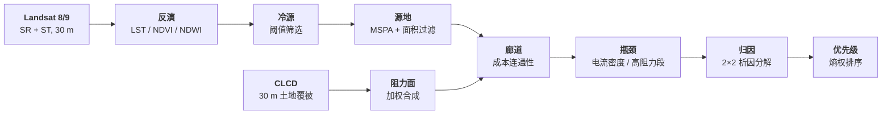

<div align="center">

# 上海市冷岛网络演变

**Evolution of Shanghai's Cool-Island Network, 2015 – 2025**

**Zane Zhang（张永轩）**

上海师范大学 · 环境与地理科学学院 · 地理信息科学

[🌐 项目主页](https://zhangyx0803.github.io/projects/cool-island-network/) |
[📄 复现步骤](https://zhangyx0803.github.io/projects/cool-island-network/) |
[📊 数据](#-数据) |
[📧 联系](#-contact)

*跨期归因：十年间冷岛网络怎么变，变化来自源地格局还是阻力面*

</div>

---

## 🔥 进展

- **[2026-10-20]** 研究框架定稿：两个研究问题、数据清单、11 步方法链与参数
- **[2026-10-04]** 12 步操作手册完成，记录实测报错与修正方式
- **[进行中]** 三期影像入库与地表温度反演
- **[未开始]** 源地、阻力面、廊道、瓶颈、归因

> 本仓库只放方法与流程说明，不放论文、图件与原始数据。

---

## 🌟 这是什么

城市冷源（林地、草地、水体）靠景观连通性把降温服务送到周边建成区。
上海十年间建设用地持续扩张，冷源与热环境同步变化，但「网络怎么变、变化由什么驱动」仍缺定量回答。

本项目用三期遥感影像识别冷源与源地，构建冷岛廊道网络，再用 **2×2 析因分解**判断：
网络的变化究竟来自**源地格局**的变动，还是来自**阻力面**的变动。

---

## ✨ 方法要点

- **冷源识别**：`LST ≤ P30` 且（`NDVI ≥ 0.4` 或 `NDWI > 0`），按属性分植被型／水体型
- **源地提取**：GuidosToolbox MSPA（边缘 1 像元、八邻域），核心区 ≥ 0.1 km²、源地 ≥ 1 km²
- **阻力面**：土地利用 0.40 · 不透水面 0.25 · NDVI 0.20 · 距水体 0.15，加权合成
- **廊道**：整数化路由面作成本栅格，源地作输入，`Cost Connectivity` 求最小生成树路径
- **瓶颈**：廊道邻域阻力均值找高阻力段；Circuitscape 成对模式算电流密度取夹点
- **归因**：两期源地 × 两期阻力面四种组合，拆成源地效应、阻力效应与交互项
- **排序**：改善潜力 × 热环境紧迫性，熵权法定权，跨期用同一套权重

---

## 🔧 流程



---

## 🚀 快速开始

工具链：**ArcGIS Pro**（arcpy）、**Python**（rasterio / numpy）、**GuidosToolbox 2.8**、**Circuitscape 5**。
每一步的产出都是一个可单独检查的中间件，后面的步骤只依赖上一步。

### Step 1 — 建公共网格

ArcGIS Pro，`arcpy.management.CreateFishnet` 生成覆盖上海市全域的 30 m 全 0 栅格。
**之后所有输出都对它对齐**，否则做差值会错行。

### Step 2 — 裁剪与投影

```text
arcpy.management.Project(in_raster, out_raster, "EPSG:4549")
```

16 个区先 `Dissolve` 融合为市域，再按市界裁剪（约 8205 km²，含崇明、长兴、横沙）。

### Step 3 — 反演地表温度

Python（rasterio + numpy）读 MTL 定标系数，QA 波段做云掩膜，输出 LST、NDVI、NDWI。

```text
# 归一化指数要防除零，越界值夹回边界而不是删除
Con(NIR + Red > 0, (NIR - Red) / (NIR + Red), 0)
```

### Step 4 — 识别冷源

```text
Con(LST <= P30 AND (NDVI >= 0.4 OR NDWI > 0), 1, 0)
```

### Step 5 — 提取源地

GuidosToolbox → MSPA，参数：边缘宽度 1 像元、八邻域。
再按核心区 ≥ 0.1 km²、源地 ≥ 1 km² 过滤碎斑。

### Step 6 — 构建阻力面

```text
Weighted Sum(landuse 0.40, impervious 0.25, ndvi 0.20, dist_water 0.15)
```

按任务派生两个面：**路由面**（水面赋高值，避免廊道穿水）与**陆地面**（水面低阻力，用于找障碍段）。

### Step 7 — 提取廊道

路由面整数化后作成本栅格，源地作输入，`Cost Connectivity` 输出最小生成树路径。

### Step 8 — 找瓶颈

- 廊道邻域阻力均值 → 高阻力段
- Circuitscape 成对模式 → 电流密度 → 夹点
- 陆地面邻域 → 障碍区段

### Step 9 — 归因

四种组合（两期源地 × 两期阻力面）分别算网络指标，拆成源地效应、阻力效应与交互项。

### Step 10 — 排序

改善潜力 × 热环境紧迫性，熵权法定权；跨期比较必须用同一套权重。

---

## 🗂️ 仓库结构

```text
README.md            本文件：方法、流程与参数
```

> 代码与参数表随分析推进陆续整理进来；论文、图件与原始数据不在本仓库。

---

## 📊 数据

| 数据 | 来源 | 分辨率 | 时相 |
| --- | --- | --- | --- |
| Landsat 8/9 Collection 2 Level-2 | USGS EarthExplorer（WRS-2 118/038、118/039） | 30 m（热红外 100 m） | 2015 / 2020 / 2025 |
| CLCD v1.0.5 | 武汉大学，Zenodo `18180184` | 30 m 年度 | 2015 / 2020 / 2025 |
| 行政边界 | 公开行政区划数据 | 矢量 | 2024 |

原始影像受 USGS 条款约束，不随仓库分发。

---

## 📧 Contact

如需数据或合作，请联系：<zhangyx0803@petalmail.com>

个人主页：<https://zhangyx0803.github.io/>
