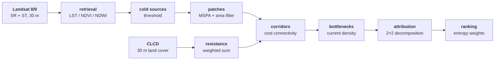

<div align="center">

# Evolution of Shanghai's Cool-Island Network

**2015 – 2025, attribution across periods**

**Zane Zhang**

Shanghai Normal University · School of Environmental and Geographical Sciences

[🌐 Project page](https://zhangyx0803.github.io/projects/cool-island-network/) |
[🐍 Scripts](scripts/) |
[📊 Data](#-data) |
[📧 Contact](#-contact)

*How the network changed over a decade, and whether the change came from sources or from resistance*

</div>

---

## 🔥 Progress

- **[2026-10]** Research framework fixed: two questions, data inventory, an 11-step method chain with parameters.
- **[2026-10]** A 12-step operating handbook written, including errors met in practice and the fixes.
- **[ongoing]** Imagery ingestion and land surface temperature retrieval.
- **[not started]** Patches, resistance surfaces, corridors, bottlenecks, attribution.

> This repository holds method notes and analysis scripts. Manuscripts, figures and raw data are not distributed.

---

## 🌟 What this is

Urban cold sources — woodland, grassland, water — deliver cooling through landscape connectivity.
Shanghai's built-up area kept expanding over the decade, so sources and thermal environment changed together,
yet how the network changed, and what drove it, has not been quantified.

The project identifies cold sources and source patches from three periods of satellite imagery, builds a
cool-island corridor network, and uses a **2×2 factorial decomposition** to ask whether the change came from
the **source pattern** or from the **resistance surface**.

---

## ✨ Method

- **Cold sources** — `LST ≤ P30` and (`NDVI ≥ 0.4` or `NDWI > 0`), split into vegetation and water types.
- **Source patches** — GuidosToolbox MSPA (edge width 1 px, eight-neighbour), then cores ≥ 0.1 km², sources ≥ 1 km².
- **Resistance surface** — land use 0.40 · impervious 0.25 · NDVI 0.20 · distance to water 0.15.
- **Corridors** — integer routing surface as cost raster, source patches as input, `Cost Connectivity` for the minimum spanning tree.
- **Bottlenecks** — high-resistance corridor segments from a neighbourhood mean; Circuitscape pairwise current density for pinch points.
- **Attribution** — two source periods × two resistance surfaces, split into source effect, resistance effect and interaction.
- **Ranking** — improvement potential × thermal urgency, entropy weights, identical weights across periods.

---

## 🔧 Workflow



---

## 🚀 Quick start

Toolchain: **ArcGIS Pro** (arcpy), **Python** (rasterio / numpy), **GuidosToolbox 2.8**, **Circuitscape 5**.
Each step writes an intermediate you can inspect on its own; later steps only depend on the previous one.

### Step 1 — Common grid

```python
arcpy.management.CreateFishnet(...)   # 30 m, all-zero, covering the municipality
```

Everything downstream aligns to this grid; skipping it makes difference maps misregister.

### Step 2 — Clip and project

```python
arcpy.management.Project(in_raster, out_raster, "EPSG:4549")
```

Dissolve the 16 districts into the city extent first (about 8,205 km², including Chongming, Changxing, Hengsha).

### Step 3 — Land surface temperature

Read MTL calibration coefficients, mask clouds with the QA band, write LST, NDVI and NDWI.

```text
# guard against division by zero; clamp out-of-range values instead of deleting pixels
Con(NIR + Red > 0, (NIR - Red) / (NIR + Red), 0)
```

### Step 4 — Cold sources

```text
Con(LST <= P30 AND (NDVI >= 0.4 OR NDWI > 0), 1, 0)
```

### Step 5 — Source patches

GuidosToolbox → MSPA, edge width 1 px, eight-neighbour. Keep cores ≥ 0.1 km² and sources ≥ 1 km².

### Step 6 — Resistance surface

```text
Weighted Sum(landuse 0.40, impervious 0.25, ndvi 0.20, dist_water 0.15)
```

Derive two more from it: a **routing surface** (water penalised, so corridors do not cross the river) and a
**land surface** (water cheap, used to find barrier segments).

### Step 7 — Corridors

Integerise the routing surface, use it as the cost raster with source patches as input, run `Cost Connectivity`,
keep the minimum spanning tree paths.

### Step 8 — Bottlenecks

- corridor neighbourhood mean → high-resistance segments
- Circuitscape pairwise mode → current density → pinch points
- land-surface neighbourhood → barrier segments

### Step 9 — Attribution

Four combinations (two source periods × two resistance surfaces), compute network metrics for each, split into
source effect, resistance effect and interaction.

### Step 10 — Ranking

Improvement potential × thermal urgency, entropy weights; comparisons across periods must use the same weights.

---

## 🗂️ Repository layout

```text
scripts/
  mst_network2.py         minimum spanning tree network, self-tracing path reconstruction
  mst_network_max.py      MST variant over the maximum-cost surface
  mst_network_suit.py     MST variant over the suitability surface
  corridor_eval.py        corridor length, connectivity and per-period comparison
  corridor_bottleneck.py  P95 and absolute-threshold bottleneck identification
```

Scripts need an ArcGIS Pro Python environment with the Spatial Analyst extension. Local paths were rewritten to
`data/` and `outputs/` placeholders before publication; adjust them at the top of each script.

---

## 📊 Data

| Dataset | Source | Resolution | Time |
| --- | --- | --- | --- |
| Landsat 8/9 Collection 2 Level-2 | USGS EarthExplorer (WRS-2 118/038, 118/039) | 30 m (thermal 100 m) | 2015 / 2020 / 2025 |
| CLCD v1.0.5 | Wuhan University, Zenodo `18180184` | 30 m annual | 2015 / 2020 / 2025 |
| Administrative boundaries | public boundary data | vector | 2024 |

Imagery is bound by USGS terms and is not distributed with this repository.

---

## 📧 Contact

For data or collaboration: <zhangyx0803@petalmail.com>

Homepage: <https://zhangyx0803.github.io/>
