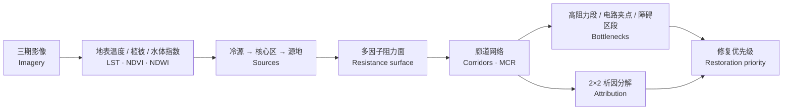

# 上海市冷岛网络演变分析（2015—2025）

**Evolution of Shanghai's Urban Cool-Island Network (2015–2025)**
基于 MSPA、MCR 与电路理论的跨期归因分析
*Cross-period attribution with MSPA, MCR and circuit theory*

  
  
  

---

## 这是什么 / What this is

一个关于**城市冷岛网络如何在十年间演变**的研究项目：以上海市全域为研究区，
用三期遥感影像识别冷源与源地，构建冷岛廊道网络，并尝试回答"变化来自哪里、先修哪里"。

*A study of how an urban cool-island network evolves over a decade: three epochs of satellite imagery,
source patches, corridor networks — and the question of what drives the change and where restoration should start.*

> 本仓库只放**项目说明与方法框架**。
> 论文原文、图件与原始数据均未公开。
> *This repository documents the project and its method framework only. The manuscript, figures and raw data are not published.*

---

## 研究问题 / Research questions

1. 十年间冷岛网络的空间格局如何变化？——源地、廊道、连通性、重心。
    *How did the network's spatial pattern change over ten years?*
2. 变化主要由**源地格局**变动引起，还是由**阻力面**变动引起？
    *Is the change driven by the source pattern or by the resistance surface?*

已有研究多在单一时相描述"网络在哪里"，跨期归因较少；高阻力段与电路理论夹点两类瓶颈指标也常被混用。
本项目把两者放进同一网络并行比较。

---

## 方法框架 / Method framework

| 环节 | 方法 |
| --- | --- |
| 冷源与核心区 | 热环境 + 地表属性双条件识别；形态学空间格局分析（MSPA） |
| 阻力面 | 多因子加权合成，按任务派生不同水面处理方案 |
| 廊道 | 最小累积阻力模型（MCR），成本连通性 |
| 瓶颈 | 廊道邻域高阻力段；电路理论（Circuitscape）电流密度夹点；陆地阻力障碍区段 |
| 归因 | 2×2 析因分解：源地效应 / 阻力效应 / 交互项 |
| 优先级 | 改善潜力 × 热环境紧迫性，熵权法定权 |

**工具 / Tools**：ArcGIS Pro 3.7（arcpy + Spatial Analyst）、GuidosToolbox、Circuitscape、Python

---

## 数据来源 / Data sources

只用公开数据，仓库内**不含**任何影像或矢量数据：

| 数据 | 来源 |
| --- | --- |
| Landsat 8/9 Collection 2 Level-2（地表反射率与地表温度） | [USGS EarthExplorer](https://earthexplorer.usgs.gov/) |
| 中国 30 m 年度土地覆被（CLCD） | 武汉大学，Zenodo 记录 [18180184](https://zenodo.org/records/18180184) |
| 县级行政边界 | 公开行政区划数据 |

---

## 状态 / Status

| 阶段 | 状态 |
| --- | --- |
| 文献与方法设计 | 完成 |
| 数据获取 | 进行中 |
| 遥感反演与冷源识别 | 待开始 |
| 网络构建与瓶颈识别 | 待开始 |
| 归因分解与优先级评价 | 待开始 |

---

## 说明 / Notes

- 廊道由 **MCR** 求解，电路理论只用于**夹点识别**——两者分工明确，不混用结果。
- 同一网络按任务使用不同阻力面（统计格局 / 廊道路由 / 障碍区段）。
- 研究区为上海市全域（含崇明、长兴、横沙三岛），统一使用 CGCS2000 三度带高斯-克吕格投影。
